<p align="center">
  
</p>

<h1 align="center">ScrumSpecter</h1>

<p align="center">
  <strong>Sprint planning and task tracking for small agile teams.</strong><br />
  Plan the sprint, see who's on what, and hit the deadline without the enterprise bloat.
</p>

<p align="center">
  <a href="https://scrumspecter.vercel.app"></a>
</p>

<p align="center">
  
  
  
  
  
  
  
  
  <a href="LICENSE"></a>
</p>

<p align="center">
  <a href="#-features">Features</a> ·
  <a href="#-screenshots">Screenshots</a> ·
  <a href="#-architecture">Architecture</a> ·
  <a href="#-quick-start">Quick start</a> ·
  <a href="#-environment">Environment</a> ·
  <a href="docs/self-hosting.md">Self-hosting</a>
</p>

<p align="center">
  <picture>
    <source media="(prefers-color-scheme: dark)" srcset="docs/screenshots/dark/desktop/home.png" />
    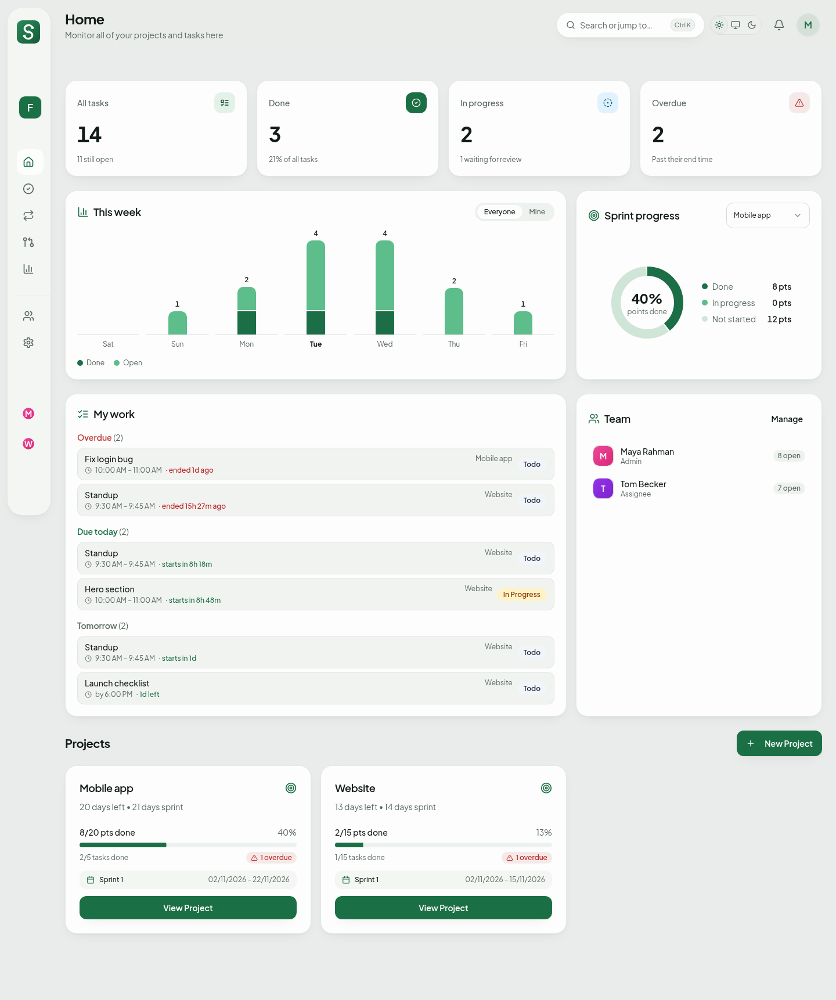
  </picture>
</p>

## ✨ Why ScrumSpecter

| | |
|---|---|
| 🗂️ **Three views, one board** | Table, kanban and calendar, all with drag and drop, undo and bulk edit. |
| 👥 **Roles that fit real teams** | Admins, Supervisors, Reviewers, Assignees and Viewers. Anyone without edit rights proposes a change request instead. |
| 🔁 **Routines that plan themselves** | Weekly tasks are generated through the end of the sprint and skip holidays and your days off. Personal routines (no project) keep the next two weeks filled. |
| 🔔 **Reminders that land** | Push and in-app: an evening preview of tomorrow, plus a nudge before a task ends, at times you choose. |
| 🤖 **Bulk input with an AI prompt** | Set up a whole sprint in one paste. Every line is validated before anything is saved. |
| 📈 **Analytics built in** | Burndown, velocity, a capacity calculator and a Markdown sprint report. |

## 🖼️ Screenshots

<sub>Every screenshot follows your GitHub theme: light here in light mode, dark in dark mode.</sub>

| Kanban | Table |
|:-:|:-:|
| <picture>  <source media="(prefers-color-scheme: dark)" srcset="docs/screenshots/dark/desktop/kanban.png" />  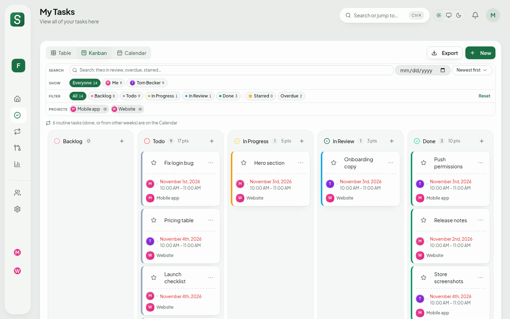</picture> | <picture>  <source media="(prefers-color-scheme: dark)" srcset="docs/screenshots/dark/desktop/table.png" />  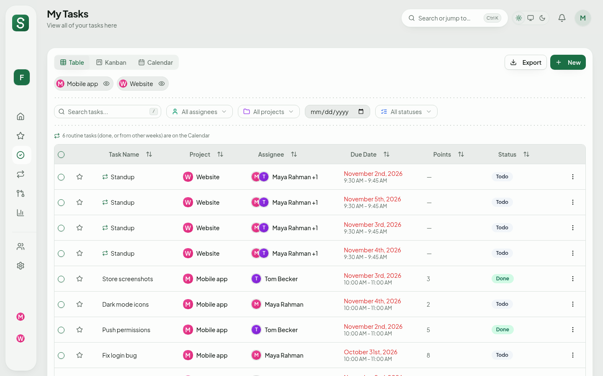</picture> |
| **Task panel** | **Analytics** |
| <picture>  <source media="(prefers-color-scheme: dark)" srcset="docs/screenshots/dark/desktop/task-panel.png" />  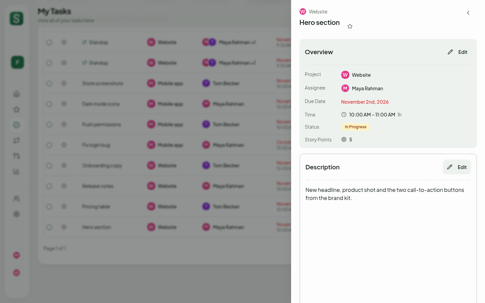</picture> | <picture>  <source media="(prefers-color-scheme: dark)" srcset="docs/screenshots/dark/desktop/analytics.png" />  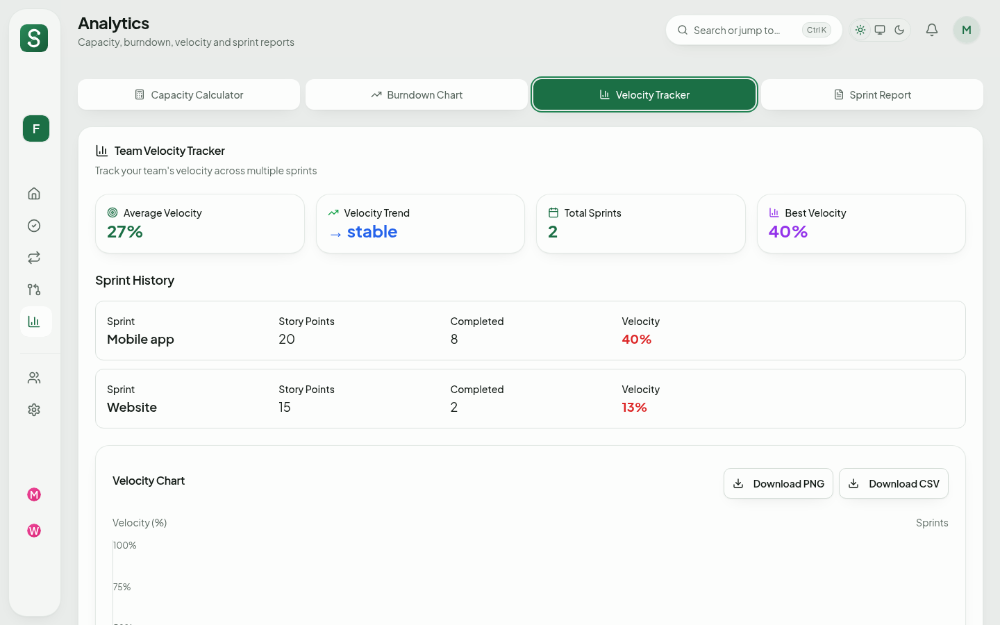</picture> |

<p align="center">
  <picture>
    <source media="(prefers-color-scheme: dark)" srcset="docs/screenshots/dark/desktop/routines.png" />
    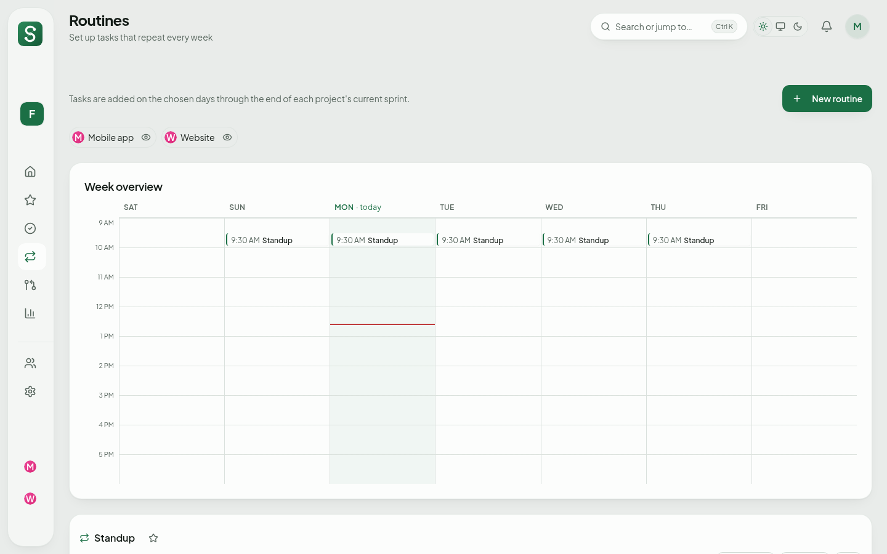
  </picture>
</p>
<p align="center"><sub>Routines: each one picks whether its tasks show in the table, kanban and calendar</sub></p>

<p align="center">
  <picture>
    <source media="(prefers-color-scheme: dark)" srcset="docs/screenshots/dark/desktop/calendar.png" />
    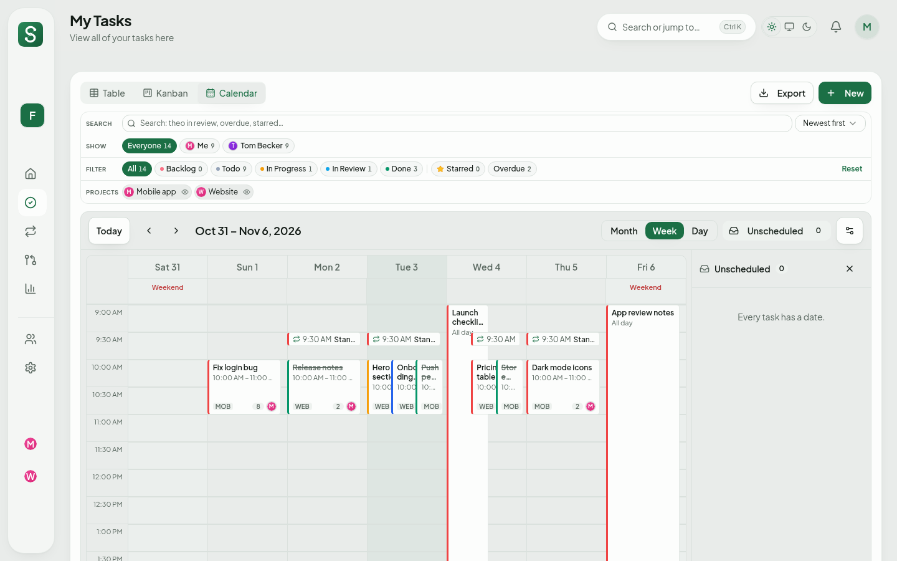
  </picture>
</p>
<p align="center"><sub>Calendar week: time blocks, all-day tasks across the working day, and days off named above the hours</sub></p>

### 📱 On a phone

<p align="center">
  <picture>
    <source media="(prefers-color-scheme: dark)" srcset="docs/screenshots/dark/mobile/home-1.png" />
    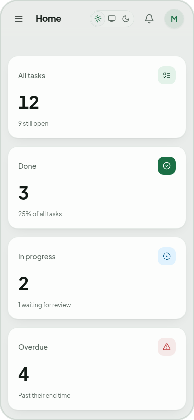
  </picture>
  &nbsp;&nbsp;
  <picture>
    <source media="(prefers-color-scheme: dark)" srcset="docs/screenshots/dark/mobile/home-2.png" />
    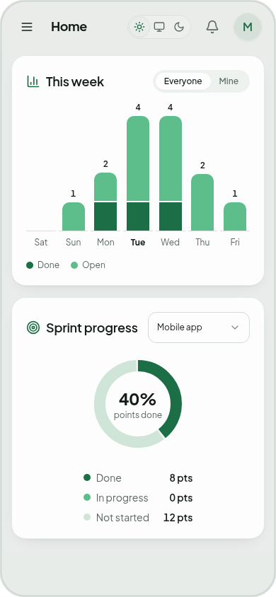
  </picture>
  &nbsp;&nbsp;
  <picture>
    <source media="(prefers-color-scheme: dark)" srcset="docs/screenshots/dark/mobile/home-3.png" />
    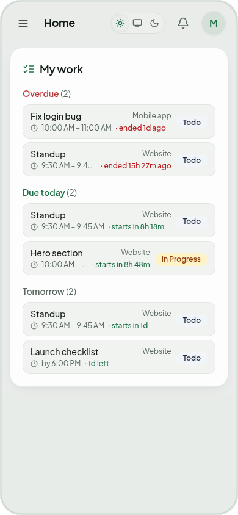
  </picture>
</p>
<p align="center"><sub>Home, scrolling down: task counts · this week and sprint progress · my work and the team</sub></p>

<p align="center">
  <picture>
    <source media="(prefers-color-scheme: dark)" srcset="docs/screenshots/dark/mobile/home-4.png" />
    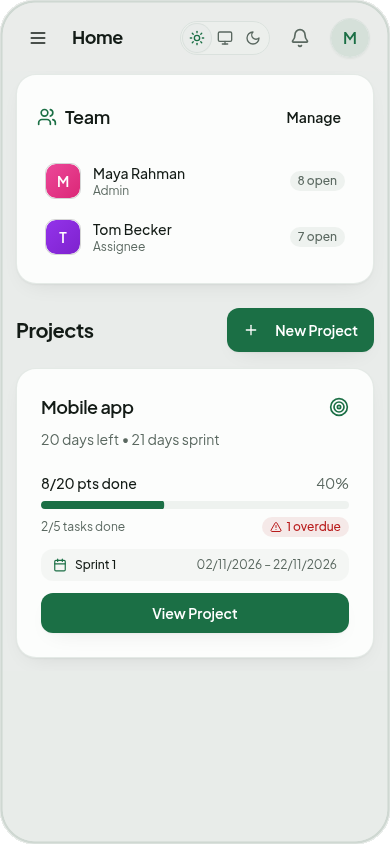
  </picture>
  &nbsp;&nbsp;
  <picture>
    <source media="(prefers-color-scheme: dark)" srcset="docs/screenshots/dark/mobile/kanban.png" />
    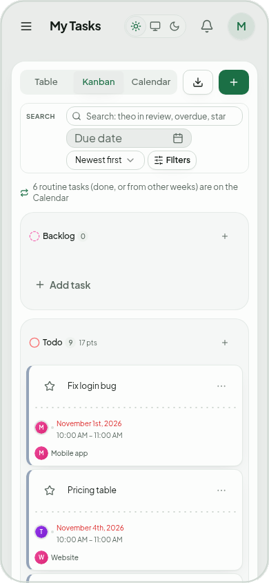
  </picture>
  &nbsp;&nbsp;
  <picture>
    <source media="(prefers-color-scheme: dark)" srcset="docs/screenshots/dark/mobile/menu.png" />
    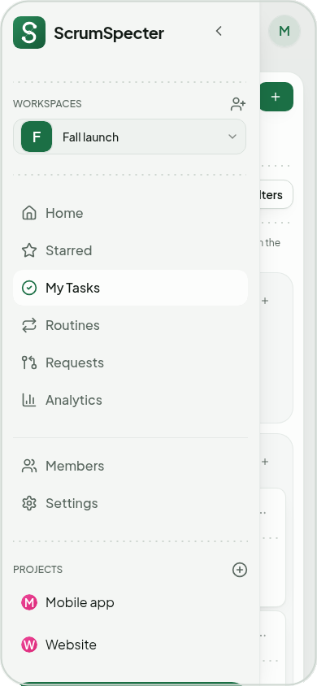
  </picture>
</p>
<p align="center"><sub>Projects · the kanban board · the menu</sub></p>

<p align="center"><sub>Works on phones and installs as an app. Light and dark themes throughout.</sub></p>

## 🧩 Features

<details>
<summary><strong>🗂️ Planning</strong></summary>

- **Workspaces, projects and sprints.** Each project has a sprint (start and end date). Its countdown, story points and progress show on the dashboard. The end date can't be before the start, whichever of the two you change.
- **Tasks:**
  - story points, due dates, optional time blocks (start time and duration), descriptions, and up to 20 assignees;
  - five statuses: Backlog, To Do, In Progress, In Review and Done;
  - three views: a table, a kanban board and a calendar, all with drag and drop;
  - in the table, clicking a row opens the task in a side panel; Shift-click selects a range of rows and Ctrl/⌘-click adds or removes one, for bulk edit;
  - Undo after deleting or moving a task;
  - the database records when a task was finished, and keeps it through edits and drags (the burndown uses it);
  - a task is **overdue** once its time block has ended or, for a task with only a date, once the workspace's working day has ended on that date in your time zone. Home, the Overdue filter and the project cards all use this one rule;
  - in the calendar's Week and Day views, tasks with a due date but no time fill the working day in the timeline, and the strip above the hours names holidays and weekends; on a phone the week scrolls sideways;
  - the calendar's Unscheduled panel lists tasks with no date, to drag onto a day or hour; it loads the first 100 and says so when there are more (the count shows all of them);
  - drag a Kanban card, a calendar task, a routine or your own pending request to the bin on the right edge of the page to delete (or withdraw) it; the menus do the same from the keyboard.
  - rest the mouse on a Kanban card for a moment to see a preview: the full name, status, points, date, project, assignees and description (mouse only; a tap opens the task);
- **Filters:** My Tasks has a compact filter block, saved on your account: whose tasks (any people in the workspace), which statuses, Starred and Overdue, each chip with a live count, plus a search box that reads plain words (`tom in review overdue`, `mine today`, `no project`; quotes search names only) and shows what it understood; Enter turns those words into chips. The older forms (`status:todo`, `@tom`, `project:web`, `is:starred`, `due:today`) still work. Home follows it; Routines have their own.
- **Saved filters and eyes:** filters are saved per workspace and per project on your account, and saving merges entry by entry, so two devices saving different filters don't overwrite each other. An eye on a project changes only that project. Deleting a project or workspace, or leaving one, removes its saved filters and eyes.
- **Starred:** star tasks and routines, then filter to them (the calendar too).
- **Export:** tasks as CSV or a calendar file (`.ics`), a private calendar-subscribe link for Google or Apple Calendar, the whole workspace as a bulk-input script or a JSON backup (Admins; streamed, so large workspaces work), analytics charts as PNG or CSV, and your own data.
- **Home ("My work"):** your overdue tasks and those due today and tomorrow, with a countdown to each one's end time.
- **My Tasks:** an eye beside each project hides or shows its tasks there. The choice is saved to your account; picking a project in the filter still shows it.
- **Routines:** tasks that repeat weekly. They're created for each of their weekdays through the end of the sprint, and they skip days off. A routine (or task) can also be personal, with no project: its tasks keep the next 14 days filled. Each routine chooses which task views (table, kanban, calendar) list its tasks, with toggles right on its card on the Routines page; Home and My work always do.
- **Routines week overview:** a routine's weekday and time are shown in your time zone (an evening run in Los Angeles is next morning's in Dhaka), and a run that goes past midnight continues on the next weekday.
- **Days off and working hours:** public holidays come from a country feed, and you can add your own days off. The weekend follows the country unless you pick its days in Settings → Holidays. Working hours frame the routines week and the calendar's all-day tasks, and decide when unfinished To Do tasks move to Backlog.
- **Limits:** 20 workspaces per account; per workspace 100 projects, 100 routines, 20,000 tasks, 500 members (people and placeholders together) and 1,000 days off; 10 notification devices per account. Days off and sprint dates must be real calendar days.

</details>

<details>
<summary><strong>👥 Team and permissions</strong></summary>

- **Roles:**

  | | Admin | Supervisor | Reviewer | Assignee | Viewer |
  |---|:-:|:-:|:-:|:-:|:-:|
  | See everything | ✓ | ✓ | ✓ | ✓ | ✓ |
  | Move own tasks up to In Review | ✓ | ✓ | ✓ | ✓ | |
  | Approve to Done, reopen, any task's status | ✓ | ✓ | ✓ | | |
  | Create, edit and delete tasks, routines and projects; bulk input | ✓ | ✓ | | | |
  | Members, roles, invites, settings, days off | ✓ | | | | |

  Reviewers and Assignees request changes instead (see Change requests below). Placeholders stand in for people who haven't joined yet.
- **Change requests:** Reviewers and Assignees propose new tasks, edits or deletions. Admins and Supervisors approve or decline them on the **Requests** page, and both sides are notified.
- **Invites:**
  - an invite link for Assignees, with an optional expiry (1, 7 or 30 days) and use limit (Viewers don't see it, since it would let them add an Assignee account);
  - a separate link for Viewers;
  - links that survive signing in.

</details>

<details>
<summary><strong>🔔 Notifications</strong></summary>

- **Notifications:** in-app and push.
  - a summary of tomorrow's tasks the day before (6 PM unless you pick another time);
  - a reminder before a task ends (10, 15, 30 or 60 minutes; 30 by default);
  - change-request decisions;
  - up to 10 devices per account, listed in Notification settings with a Remove button for any that no longer exist (a device is also dropped when its push service says it is gone); "Send a test" is limited to 20 an hour; a push that gets no answer or a server error is tried once more, since the reminder is recorded before it is pushed;
  - the bell stays in sync across your devices: reading a notification on one clears it on the others.

</details>

<details>
<summary><strong>⚡ Getting started and bulk input</strong></summary>

- **Getting started** (`/workspaces/create`): create a workspace, join one by pasting an invite link, or set a new one up from bulk commands. `?start=join` or `?start=bulk` opens a tab directly.
- **Bulk input** (Settings → Bulk input, or the getting-started page for a new workspace): add, update or remove many projects, tasks, routines, days off and placeholders at once, one command per line. Every line is checked before anything is saved, the whole script applies all or nothing, removals ask first (deleted tasks can be undone), and "Copy AI prompt" lets an AI assistant write the commands. Routines in the check results have Table / Kanban / Calendar toggles. Reviewers and Assignees can use it for tasks: their own are saved, anyone else's are sent as change requests with one notification; Viewers can't use it.

</details>

<details>
<summary><strong>📈 Analytics</strong></summary>

- **Capacity calculator:** pick a project; each assigned person gets daily hours (0 to 24) and availability (0 to 100 %). The total is always the sum of the rows and follows every edit.
- **Burndown chart:** the ideal line against the points still open on each day up to today, taken from when tasks were finished (days to come stay empty). The length comes from the project's own sprint dates, and the Progress colour compares with how far into the sprint you are. Download it as PNG or CSV.
- **Velocity tracker:** one bar per project, oldest to newest; the trend compares the newest three with the average.
- **Sprint report:** a Markdown report (also printable) with the same burndown, using the project's real sprint length, and a status breakdown that covers all five statuses so it adds up to the task total.

</details>

<details>
<summary><strong>🔐 Accounts</strong></summary>

- **Accounts:**
  - email and password or Google sign-in;
  - forgot-password emails, and an email-verification link at sign-up;
  - lockout after repeated failed logins (guesses are counted before the password is checked, so a burst can't slip through);
  - a password reset signs every device out and also ends the secret calendar-subscribe link;
  - a list of signed-in devices;
  - preferences saved to the account: default task view, week start, 12 or 24-hour time, date format, time zone, reminders, landing page, theme, reduce motion, calendar defaults, My Tasks sort / page size / Done tasks, and Kanban card size and empty columns.

</details>

<details>
<summary><strong>🧭 Getting around</strong></summary>

- **Getting around:**
  - a welcome tour on first sign-in (replay it from Ctrl K or the account menu);
  - Ctrl/⌘ K quick jump;
  - keyboard shortcuts (press `?` to see them);
  - dark mode;
  - keyboard-only use: dialogs keep focus inside and hand it back, Kanban cards move with Space and the arrow keys, calendar tasks open with Enter; charts have text tables for screen readers;
  - works on phones and can be installed as an app.

</details>

## 🏗️ Architecture

Next.js 16 (App Router, React 19), TypeScript, Tailwind CSS with shadcn/ui, a [Hono](https://hono.dev) API under `/api` with typed client calls (`src/lib/rpc.ts`), TanStack Query (cached in the browser), Motion for animation, and Drizzle ORM with self-hosted PostgreSQL 17. It's hosted on Vercel.

The kanban and calendar views and the popup forms load on first use (`src/components/lazy-parts.tsx`), and are prefetched in the background once a page is idle (in production builds).

Views load only the tasks they show, so large workspaces stay fast (`src/features/tasks/server/task-list.ts`):
- the table loads 25 per page, sorted on the server;
- kanban loads every open task and the 100 most recently finished;
- the calendar loads the dates on screen, plus undated tasks;
- Home's numbers come from `GET /api/tasks/summary`.

Routine rules (this week only, per-view toggles) are applied on the server too.

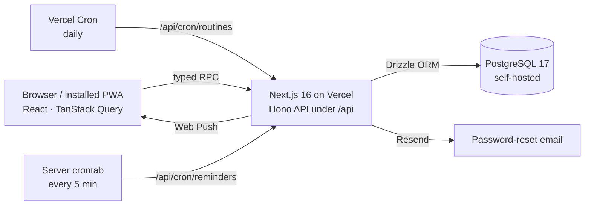

```
src/
  app/               pages: (auth), (dashboard), (standalone); API entry in app/api/[[...route]]
  features/<name>/   api/ (query hooks), components/, server/route.ts (Hono), schemas, types
  lib/               db (schema, pool), auth, routines, reminders, push, email, cron helpers
drizzle/             SQL migrations
e2e/                 Playwright end-to-end tests
```

## 🚀 Quick start

1. `npm install`
2. Copy `.env.example` to `.env.local` and fill it in (see [Environment](#-environment)).
3. `npm run db:migrate`
4. `npm run dev`, then open http://localhost:3000.

| Script | What it does |
|---|---|
| `npm run dev` / `build` / `start` | Next.js |
| `npm run lint` | ESLint |
| `npm run db:generate` | Writes a migration after a change to `src/lib/db/schema.ts` |
| `npm run db:migrate` | Applies migrations to `DATABASE_URL` |
| `npm run test:e2e` | Playwright suite (Chromium, `next dev`) |
| `npm run test:all` | Every check, one after another: types, lint, Chromium, Firefox, WebKit (Docker), a production build and its suite, and the screen-size run. About two hours; see below |

### Tests

`npm run test:all` (`scripts/test-all.sh [stage ...]`) is the full check before calling UI work done: it runs the suite in Chromium, Firefox, WebKit (inside Playwright's Docker image, `scripts/e2e-webkit.sh`), and against a production build (`E2E_PROD=1`, `next start`, where the dev-only cron-clock and push tests skip themselves), then the screen-size run. It writes logs and `summary.txt` to `~/.cache/scrumspecter-tests/<time>` and keeps a failing stage's traces. Run it detached, one Playwright run at a time (they share ports 3100 and 55433). A few tests use "today" in the Dhaka time zone, so don't start a full run in the 15 minutes before midnight there.

Run one Playwright run at a time: they share ports 3100 and 55433, and a second start clears `test-results/` and breaks the first. A stopped run can leave its `next dev` processes behind; stop them by process number before starting again.

`npm run test:e2e` starts its own in-memory Postgres (PGlite, `e2e/db-server.mjs`) and its own `next dev` (build folder `.next-e2e`), so it never touches a real database. It covers:
- **the API:** auth, roles, change requests, bulk input and edit, bulk workspace setup, invites, routine views, cron jobs;
- **the browser:** sign-up and getting started, views, the welcome tour, roles and change requests, the task panel opening and closing from every entry point, loading skeletons, the Home dashboard, every page with and without reduced motion, phone layouts, drag to the bin, preferences;
- **accessibility:** axe checks (WCAG 2.1 AA) on the main pages in both themes, and a keyboard-only walk through the sidebar, quick jump, dialogs, the task panel, Kanban and the calendar.
- **screens and browsers** (on demand: `COMPAT=<folder> npx playwright test e2e/compat.spec.ts`): 15 pages at 22 sizes, from a 320px phone and a folding phone's cover screen to a 2560px monitor, plus 200% and 400% browser zoom and larger text, in Chromium, Chromium with forced dark mode, and Firefox. It flags anything cut off at the screen edge, text fields that would make iPhone Safari zoom in, and page errors, and saves a screenshot of each page. WebKit (Safari, and every iPhone browser) runs in Docker with `scripts/compat-webkit.sh <folder>`.

Four runs take screenshots instead of checking things:
- `INSPECT=<folder> npx playwright test e2e/inspect.spec.ts`, then `node scripts/inspect-report.mjs <folder>`, builds a side-by-side desktop and phone page of the screens being worked on;
- `VISUAL_SHOTS=<folder> npx playwright test e2e/visual-shots.spec.ts` saves every page in light and dark, at desktop and phone size;
- `SKELETON_SHOTS=<folder> npx playwright test e2e/loading-ui.spec.ts` saves each page's loading skeleton;
- `README_SHOTS=<folder> npx playwright test e2e/readme-shots.spec.ts`, then `node scripts/readme-screenshots.mjs <folder>`, regenerates this README's screenshots in `docs/screenshots/{light,dark}/{desktop,mobile}/`. The script cuts the long phone capture of Home into framed phone screens. It needs ImageMagick.

## 🔑 Environment

| Variable | Needed | Purpose |
|---|---|---|
| `DATABASE_URL` | yes | Postgres connection string (the `scrumspecter_app` user; see below) |
| `DATABASE_SSL` | Vercel | `direct` on Vercel (TLS from the first byte, for Funnel); unset on the tailnet; `false` for a local non-TLS database |
| `NEXT_PUBLIC_APP_URL` | yes | Public base URL, used in invite, reset and push links |
| `CRON_SECRET` | yes | Bearer token for `/api/cron/*` |
| `AUTH_LINK_SECRET` | yes | Signs the pending "link Google to this account" cookie |
| `GOOGLE_CLIENT_ID`, `GOOGLE_CLIENT_SECRET` | optional | Google sign-in. Redirect URI: `${NEXT_PUBLIC_APP_URL}/api/auth/google/callback` |
| `NEXT_PUBLIC_VAPID_PUBLIC_KEY`, `VAPID_PRIVATE_KEY`, `VAPID_SUBJECT` | optional | Push notifications (`npx web-push generate-vapid-keys`) |
| `REMINDERS_INSERT_BATCH` | optional | Reminders saved per database statement (default 500; the test server uses 2) |
| `RESEND_API_KEY`, `EMAIL_FROM` | optional | Password-reset emails through [Resend](https://resend.com). Without them the link is written to the server log |
| `HOLIDAY_FEED` | optional | `off` disables the public-holiday feed |

## ⏰ Scheduled jobs

- `GET /api/cron/routines`: daily via Vercel Cron (`vercel.json`). Keeps routine tasks generated through each sprint's end (a workspace at its 20,000-task limit gets no more), then removes rows that stopped mattering: expired sessions, finished sign-in and rate-limit counters, notifications older than 90 days, and used or expired reset and verification tokens.
- `GET /api/cron/reminders`: every 5 minutes from the Pi's crontab, because Vercel's free cron runs only daily. It sends due reminders, then moves tasks still in To Do after they ended to Backlog. On the Pi this is `~/docker/postgres/reminders.sh`, which reads the secret from `cron-secret` (owner-only) and logs only failures to `reminders.log`.

Both need `Authorization: Bearer $CRON_SECRET`.

## 🛠️ Deployment and self-hosting

The live site runs on Vercel with a self-hosted PostgreSQL 17 database. The full setup (database container, TLS, users and permissions, backups, production migrations and a fresh start) is in **[docs/self-hosting.md](docs/self-hosting.md)**.

## 🤝 Contributing

Issues and pull requests are welcome. Before opening a PR:

1. Run `npm run lint`.
2. Run `npm run test:e2e`. It's self-contained, so no database setup is needed.
3. After any change to `src/lib/db/schema.ts`, run `npm run db:generate` and commit the migration.

## 📄 License

[MIT](LICENSE) © 2026 MASH2RAFI
