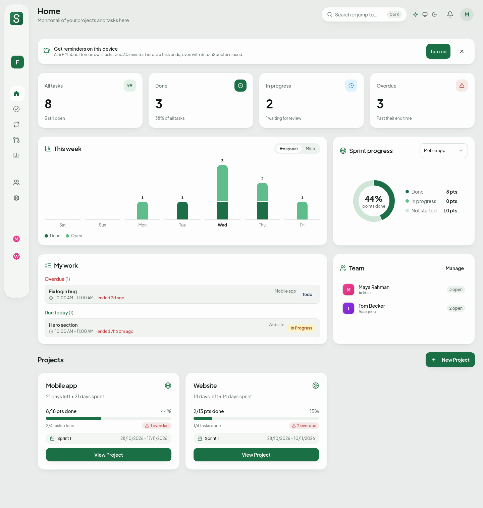
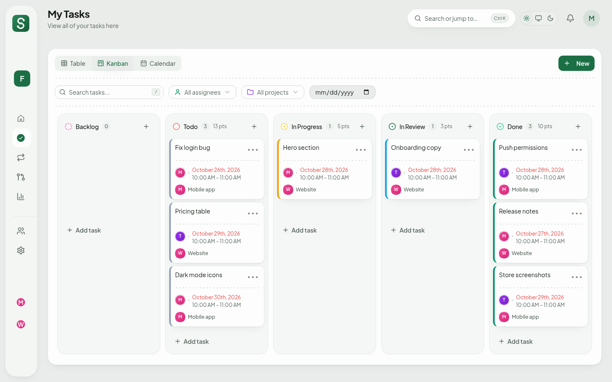
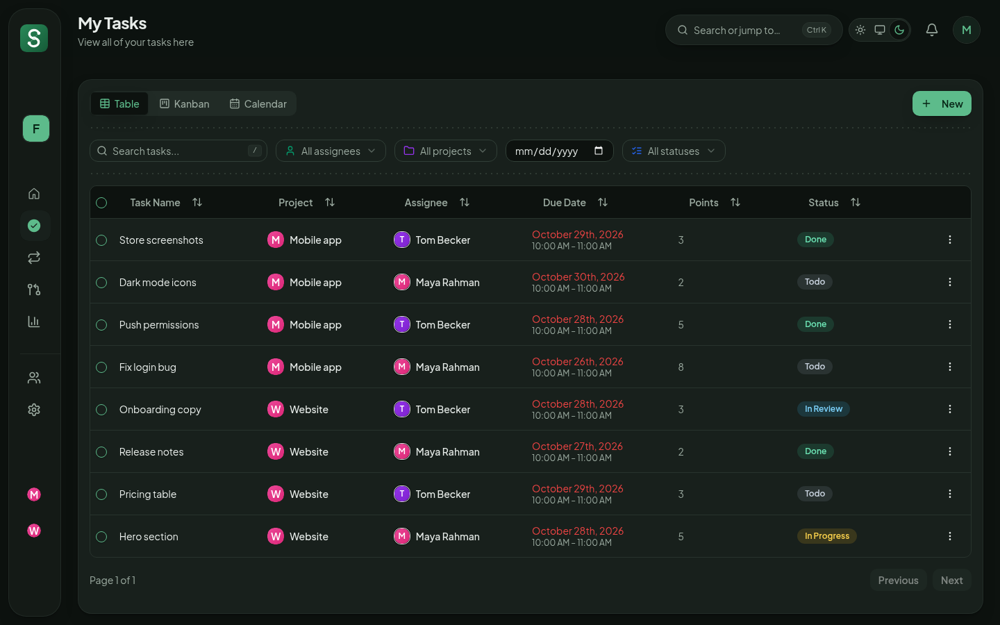
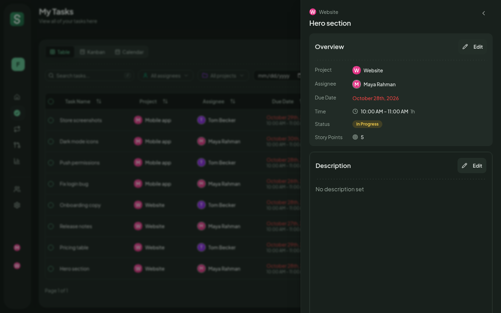
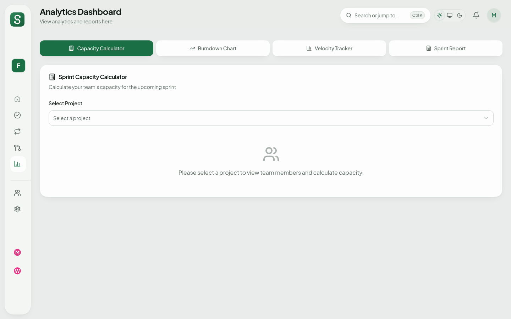
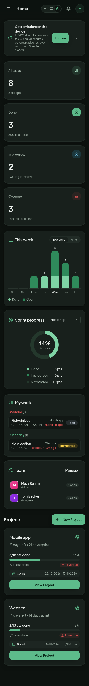
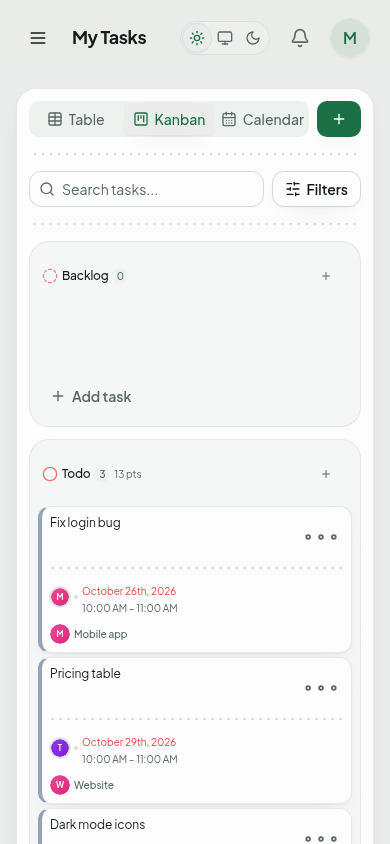
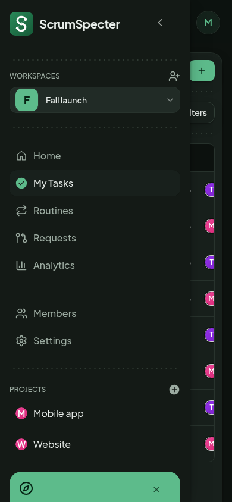
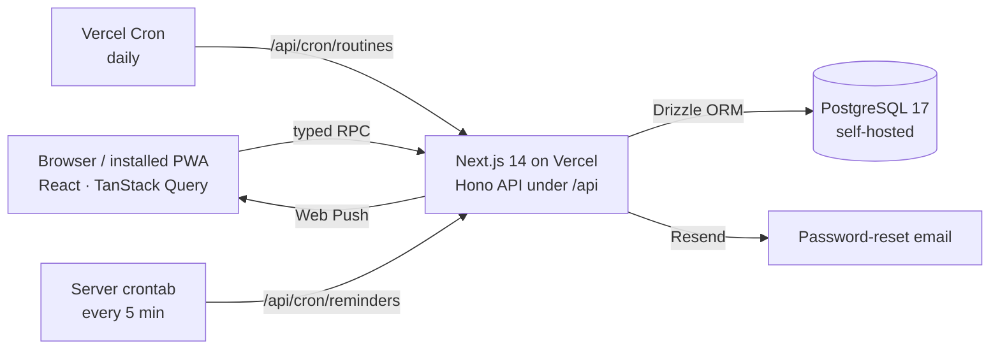

<p align="center">
  
</p>

<h1 align="center">ScrumSpecter</h1>

<p align="center">
  <strong>Sprint planning and task tracking for small agile teams.</strong><br />
  Plan the sprint, see who's on what, and hit the deadline without the enterprise bloat.
</p>

<p align="center">
  <a href="https://scrumspecter.vercel.app"></a>
</p>

<p align="center">
  
  
  
  
  
  
  
  
  <a href="LICENSE"></a>
</p>

<p align="center">
  <a href="#-features">Features</a> ·
  <a href="#-screenshots">Screenshots</a> ·
  <a href="#-architecture">Architecture</a> ·
  <a href="#-quick-start">Quick start</a> ·
  <a href="#-environment">Environment</a> ·
  <a href="docs/self-hosting.md">Self-hosting</a>
</p>

<p align="center">
  <picture>
    <source media="(prefers-color-scheme: dark)" srcset="docs/screenshots/home-dark-desktop.png" />
    
  </picture>
</p>

## ✨ Why ScrumSpecter

| | |
|---|---|
| 🗂️ **Three views, one board** | Table, kanban and calendar, all with drag and drop, undo and bulk edit. |
| 👥 **Roles that fit real teams** | Admins, Supervisors, Reviewers, Assignees and Viewers. Anyone without edit rights proposes a change request instead. |
| 🔁 **Routines that plan themselves** | Weekly tasks are generated through the end of the sprint and skip holidays and your days off. |
| 🔔 **Reminders that land** | Push and in-app: a 6 PM preview of tomorrow, plus a nudge 30 minutes before a task ends. |
| 🤖 **Bulk input with an AI prompt** | Set up a whole sprint in one paste. Every line is validated before anything is saved. |
| 📈 **Analytics built in** | Burndown, velocity, a capacity calculator and a Markdown sprint report. |

## 🖼️ Screenshots

| Kanban | Table |
|:-:|:-:|
|  |  |
| **Task panel** | **Analytics** |
|  |  |

<p align="center">
  
  &nbsp;
  
  &nbsp;
  
</p>

<p align="center"><sub>Works on phones and installs as an app. Light and dark themes throughout.</sub></p>

## 🧩 Features

<details>
<summary><strong>🗂️ Planning</strong></summary>

- **Workspaces, projects and sprints.** Each project has a sprint (start and end date). Its countdown, story points and progress show on the dashboard.
- **Tasks:**
  - story points, due dates, optional time blocks (start time and duration), descriptions, and up to 20 assignees;
  - five statuses: Backlog, To Do, In Progress, In Review and Done;
  - three views: a table, a kanban board and a calendar, all with drag and drop;
  - bulk edit from the table;
  - Undo after deleting or moving a task.
- **Home ("My work"):** your overdue tasks and those due today and tomorrow, with a countdown to each one's end time.
- **Routines:** tasks that repeat weekly. They're created for each of their weekdays through the end of the sprint, and they skip days off. Each routine chooses which task views (table, kanban, calendar) list its tasks; Home and My work always do.
- **Days off and working hours:** public holidays come from a country feed, and you can add your own days off. Working hours frame the routines week and decide when unfinished To Do tasks move to Backlog.

</details>

<details>
<summary><strong>👥 Team and permissions</strong></summary>

- **Roles:**

  | | Admin | Supervisor | Reviewer | Assignee | Viewer |
  |---|:-:|:-:|:-:|:-:|:-:|
  | See everything | ✓ | ✓ | ✓ | ✓ | ✓ |
  | Move own tasks up to In Review | ✓ | ✓ | ✓ | ✓ | |
  | Approve to Done, reopen, any task's status | ✓ | ✓ | ✓ | | |
  | Create, edit and delete tasks, routines and projects; bulk input | ✓ | ✓ | | | |
  | Members, roles, invites, settings, days off | ✓ | | | | |

  Reviewers and Assignees request changes instead (see Change requests below). Placeholders stand in for people who haven't joined yet.
- **Change requests:** Reviewers and Assignees propose new tasks, edits or deletions. Admins and Supervisors approve or decline them on the **Requests** page, and both sides are notified.
- **Invites:**
  - an invite link for Assignees, with an optional expiry (1, 7 or 30 days) and use limit;
  - a separate link for Viewers;
  - links that survive signing in.

</details>

<details>
<summary><strong>🔔 Notifications</strong></summary>

- **Notifications:** in-app and push.
  - 6 PM summary of tomorrow's tasks;
  - a reminder 30 minutes before a task ends;
  - change-request decisions.

</details>

<details>
<summary><strong>⚡ Getting started and bulk input</strong></summary>

- **Getting started** (`/workspaces/create`): create a workspace, join one by pasting an invite link, or set a new one up from bulk commands. `?start=join` or `?start=bulk` opens a tab directly.
- **Bulk input** (Settings → Bulk input, or the getting-started page for a new workspace): add many projects, tasks, routines, days off and placeholders at once, one command per line. Every line is checked before anything is saved, and "Copy AI prompt" lets an AI assistant write the commands.

</details>

<details>
<summary><strong>📈 Analytics</strong></summary>

- **Analytics:** capacity calculator, burndown chart, velocity tracker and a sprint report generator (Markdown).

</details>

<details>
<summary><strong>🔐 Accounts</strong></summary>

- **Accounts:**
  - email and password or Google sign-in;
  - forgot-password emails;
  - lockout after repeated failed logins;
  - a list of signed-in devices;
  - preferences: default task view, week start, 12 or 24-hour time, time zone and reminders.

</details>

<details>
<summary><strong>🧭 Getting around</strong></summary>

- **Getting around:**
  - a welcome tour on first sign-in (replay it from Ctrl K or the account menu);
  - Ctrl/⌘ K quick jump;
  - keyboard shortcuts (press `?` to see them);
  - dark mode;
  - works on phones and can be installed as an app.

</details>

## 🏗️ Architecture

Next.js 14 (App Router), TypeScript, Tailwind CSS with shadcn/ui, a [Hono](https://hono.dev) API under `/api` with typed client calls (`src/lib/rpc.ts`), TanStack Query (cached in the browser), Motion for animation, and Drizzle ORM with self-hosted PostgreSQL 17. It's hosted on Vercel.

The kanban and calendar views and the popup forms load on first use (`src/components/lazy-parts.tsx`), and are prefetched in the background once a page is idle.



```
src/
  app/               pages: (auth), (dashboard), (standalone); API entry in app/api/[[...route]]
  features/<name>/   api/ (query hooks), components/, server/route.ts (Hono), schemas, types
  lib/               db (schema, pool), auth, routines, reminders, push, email, cron helpers
drizzle/             SQL migrations
e2e/                 Playwright end-to-end tests
```

## 🚀 Quick start

1. `npm install`
2. Copy `.env.example` to `.env.local` and fill it in (see [Environment](#-environment)).
3. `npm run db:migrate`
4. `npm run dev`, then open http://localhost:3000.

| Script | What it does |
|---|---|
| `npm run dev` / `build` / `start` | Next.js |
| `npm run lint` | ESLint |
| `npm run db:generate` | Writes a migration after a change to `src/lib/db/schema.ts` |
| `npm run db:migrate` | Applies migrations to `DATABASE_URL` |
| `npm run test:e2e` | Playwright suite |

### Tests

`npm run test:e2e` starts its own in-memory Postgres (PGlite, `e2e/db-server.mjs`) and its own `next dev` (build folder `.next-e2e`), so it never touches a real database. It covers:
- **the API:** auth, roles, change requests, bulk input and edit, bulk workspace setup, invites, routine views, cron jobs;
- **the browser:** sign-up and getting started, views, the welcome tour, roles and change requests, the task panel opening and closing from every entry point, loading skeletons, the Home dashboard, every page with and without reduced motion, phone layouts.

Two runs take screenshots instead of checking things:
- `VISUAL_SHOTS=<folder> npx playwright test e2e/visual-shots.spec.ts` saves every page in light and dark, at desktop and phone size;
- `SKELETON_SHOTS=<folder> npx playwright test e2e/loading-ui.spec.ts` saves each page's loading skeleton.

## 🔑 Environment

| Variable | Needed | Purpose |
|---|---|---|
| `DATABASE_URL` | yes | Postgres connection string (the `scrumspecter_app` user; see below) |
| `DATABASE_SSL` | Vercel | `direct` on Vercel (TLS from the first byte, for Funnel); unset on the tailnet; `false` for a local non-TLS database |
| `NEXT_PUBLIC_APP_URL` | yes | Public base URL, used in invite, reset and push links |
| `CRON_SECRET` | yes | Bearer token for `/api/cron/*` |
| `AUTH_LINK_SECRET` | yes | Signs the pending "link Google to this account" cookie |
| `GOOGLE_CLIENT_ID`, `GOOGLE_CLIENT_SECRET` | optional | Google sign-in. Redirect URI: `${NEXT_PUBLIC_APP_URL}/api/auth/google/callback` |
| `NEXT_PUBLIC_VAPID_PUBLIC_KEY`, `VAPID_PRIVATE_KEY`, `VAPID_SUBJECT` | optional | Push notifications (`npx web-push generate-vapid-keys`) |
| `RESEND_API_KEY`, `EMAIL_FROM` | optional | Password-reset emails through [Resend](https://resend.com). Without them the link is written to the server log |
| `HOLIDAY_FEED` | optional | `off` disables the public-holiday feed |

## ⏰ Scheduled jobs

- `GET /api/cron/routines`: daily via Vercel Cron (`vercel.json`). Keeps routine tasks generated through each sprint's end.
- `GET /api/cron/reminders`: every 5 minutes from the Pi's crontab, because Vercel's free cron runs only daily. It sends due reminders, then moves tasks still in To Do after they ended to Backlog. On the Pi this is `~/docker/postgres/reminders.sh`, which reads the secret from `cron-secret` (owner-only) and logs only failures to `reminders.log`.

Both need `Authorization: Bearer $CRON_SECRET`.

## 🛠️ Deployment and self-hosting

The live site runs on Vercel with a self-hosted PostgreSQL 17 database. The full setup (database container, TLS, users and permissions, backups and production migrations) is in **[docs/self-hosting.md](docs/self-hosting.md)**.

## 🤝 Contributing

Issues and pull requests are welcome. Before opening a PR:

1. Run `npm run lint`.
2. Run `npm run test:e2e`. It's self-contained, so no database setup is needed.
3. After any change to `src/lib/db/schema.ts`, run `npm run db:generate` and commit the migration.

## 📄 License

[MIT](LICENSE) © 2026 MASH2RAFI
